# C — Mapa de Atores: Emissão de Passaporte Comum pela Polícia Federal

- **Serviço:** emissão de passaporte comum (tipo comum, território nacional).
- **Canal:** requerimento, pagamento e agendamento online (gov.br / SINPA), com atendimento presencial em posto de emissão.
- **Órgão responsável:** Polícia Federal (PF), vinculada ao Ministério da Justiça e Segurança Pública (MJSP).
- **Fontes:** `B_relatorio_assistente_v3.md`, que é a base de evidências, e as decisões registradas em `C_grill_transcript.md`, citadas abaixo como **R*n*-Q*m*** (Rodada *n*, Questão *m*).
- **Formato:** B, com diagrama mermaid e tabela de atores com matriz RACI por etapa (R1-Q2, R3-Q1).

## 1. Recorte (R1-Q1)

- **Entra:** o caminho feliz do adulto e as exceções que trazem atores novos: menor de idade (com sub-ramo de alvará judicial), furto ou roubo do passaporte anterior, impedimento judicial ou indeferimento, e passaporte de emergência.
- **Fica fora:** a emissão consular no exterior (MRE) e a crise de falta de caderneta ou orçamento. Por consequência, ficam fora também os atores MPO/JEO, Congresso/CMO, FUNAPOL e Idec/Procon (R2-Q6).

## 2. Etapas da jornada (R3-Q1, R4-Q2)

| Código | Etapa |
|---|---|
| E1 | Pré-serviço: reunir documentos (RG/CIN, certidões, quitação eleitoral e militar, autorização ou alvará, BO) |
| E2 | Requerimento online (formulário no SINPA via gov.br/PF) |
| E3 | Pagamento da taxa (GRU / PagTesouro: boleto, Pix, cartão) |
| E4 | Agendamento |
| E5 | Atendimento presencial: conferência documental e coleta biométrica e facial |
| E6a | Validação e deferimento: biometria, alertas e bases cadastrais, e decisão |
| E6b | Produção e remessa da caderneta (Casa da Moeda até o posto) |
| E7 | Entrega e pós-serviço (retirada, avaliação, restituição, manifestações) |

## 3. Tipologia (R1-Q5, R1-Q6, R7-Q2)

A **camada** é a categoria principal, e o **tipo** (Pessoa, Órgão, Sistema, Empresa, Norma) é um atributo. São seis camadas:

1. **Linha de frente:** tem contato direto com o cidadão.
2. **Retaguarda / sistemas:** gestão e plataformas que processam o pedido.
3. **Produção:** cadeia industrial da caderneta.
4. **Normativo e controle:** normatiza, fiscaliza e recebe manifestações. Fica fora do fluxo principal (R3-Q3).
5. **Sistema de Justiça (exceção):** atua só em ramos de exceção.
6. **Externo não oficial:** intermediários sem papel formal.

## 4. Diagrama (R3-Q3, R3-Q4, R3-Q5)

Setas contínuas indicam o fluxo da jornada. Setas tracejadas indicam normatização, fiscalização, exceção ou atuação não oficial.

```mermaid
flowchart LR
  subgraph LF["Linha de frente"]
    CID["1. Cidadão requerente"]
    RESP["2. Responsáveis legais *menor"]
    EMI["7. Emissores de documentos do pré-serviço"]
    POSTO["6. Rede de postos - próprios, conveniados, shoppings"]
    ATD["3. Atendente terceirizado do posto"]
    POL["4. Policial federal do posto"]
    DEL["5. Delegado da PF - autoridade expedidora"]
  end

  subgraph RT["Retaguarda / sistemas"]
    GEST["8. Gestão nacional da PF - DPA/CGPI/DPAS + DTI"]
    SR["23. Superintendência Regional da PF - SR/PF"]
    GOV["9. gov.br"]
    SINPA["10. SINPA"]
    PAG["11. Cadeia de pagamento - PagTesouro/STN/bancos"]
    BASES["12. Bases de validação - CPF, TSE, SERMIL"]
    ALERT["13. Sistemas de alerta - SINPI, STI, BNMP"]
    BIO["14. Identificação biométrica - ABIS, INI, IAFIS/IDEMIA"]
  end

  subgraph PROD["Produção"]
    CMB["15. Casa da Moeda + insumos e logística inferidos"]
  end

  subgraph NC["Normativo e controle"]
    MJSP["16. MJSP"]
    ICAO["17. ICAO Doc 9303"]
    CTRL["18. Órgãos de controle - TCU, CGU, ANPD"]
    OUV["19. Ouvidoria PF / Fala.BR"]
  end

  subgraph SJ["Sistema de Justiça - exceção"]
    JUD["20. Poder Judiciário"]
    DEF["21. Defesa de direitos - MPF, DPU, AGU"]
  end

  subgraph EXT["Externo não oficial"]
    DESP["22. Despachantes e sites de intermediação"]
  end

  EMI -->|"E1 emite documentos"| CID
  RESP -->|"E1 autoriza menor"| CID
  CID -->|"E2 preenche requerimento"| GOV
  GOV -->|"E2 encaminha"| SINPA
  SINPA -->|"E2 valida CPF"| BASES
  CID -->|"E3 paga taxa"| PAG
  PAG -->|"E3 confirma pagamento"| SINPA
  CID -->|"E4 agenda"| SINPA
  SR -->|"E4 define vagas locais"| SINPA
  POSTO -->|"E4 informa capacidade"| SR
  CID -->|"E5 comparece"| ATD
  ATD -->|"E5 triagem e conferência"| POL
  POL -->|"E5 coleta biometria"| BIO
  BIO -->|"E6a batimento"| SINPA
  SINPA -->|"E6a consulta"| ALERT
  SINPA -->|"E6a TSE/SERMIL"| BASES
  POL -->|"E6a trata alertas"| DEL
  DEL -->|"E6a defere"| SINPA
  SINPA -->|"E6b ordem de produção"| CMB
  GEST -->|"E6b gere contrato 40/2022"| CMB
  CMB -->|"E6b remete caderneta"| POSTO
  ATD -->|"E7 entrega"| CID
  CID -->|"E7 avalia ou reclama"| OUV

  GEST -.->|"gere canal e taxa"| SINPA
  SR -.->|"contrata terceirizados"| ATD
  SR -.->|"gere convênios e espaços"| POSTO
  MJSP -.->|"fixa taxas"| PAG
  ICAO -.->|"padrão de foto e caderneta"| BIO
  ICAO -.->|"especificação"| CMB
  CTRL -.->|"fiscaliza LGPD e contratos"| GEST
  JUD -.->|"E1 alvará supre autorização"| RESP
  JUD -.->|"E6a proibição judicial"| ALERT
  DEF -.->|"E6a contesta indeferimento"| DEL
  DESP -.->|"cobra por agendamento gratuito"| CID

  classDef sistema fill:#e8f0fe,stroke:#1a56db;
  classDef controle fill:#f3f4f6,stroke:#6b7280,stroke-dasharray: 4 3;
  classDef justica fill:#fff7e6,stroke:#b45309,stroke-dasharray: 4 3;
  classDef naooficial fill:#fde8e8,stroke:#c81e1e,stroke-width:2px,stroke-dasharray: 6 4;
  classDef inferido fill:#fefce8,stroke:#a16207,stroke-dasharray: 2 2;
  class GOV,SINPA,PAG,BASES,ALERT,BIO sistema;
  class MJSP,ICAO,CTRL,OUV controle;
  class JUD,DEF justica;
  class DESP naooficial;
  class CMB inferido;
```

## 5. Tabela de atores com matriz RACI

**Legenda:**
- **R:** executa. **A:** responde pela etapa (exatamente um A por etapa, R4-Q1). **C:** consultado. **I:** informado. **—:** sem papel.
- **\*:** letra válida só no ramo de exceção (R4-Q5).
- Sistemas nunca recebem A (R3-Q2).
- A **entrada** de um ator na jornada é a primeira etapa com letra, e a **saída** é a última (R3-Q1).

| # | Ator | Camada | Tipo | E1 | E2 | E3 | E4 | E5 | E6a | E6b | E7 | Entra | Sai | Decisões |
|---|---|---|---|---|---|---|---|---|---|---|---|---|---|---|
| 1 | Cidadão requerente | Linha de frente | Pessoa | A,R | R | R | R | R | I | I | R | E1 | E7 | R2-Q1, R4-Q4, R5-Q1 |
| 2 | Responsáveis legais | Linha de frente | Pessoa | A\*,R\* | — | — | — | R\* | — | — | R\* | E1\* | E7\* | R2-Q1, R5-Q1, R6-Q1, R7-Q4 |
| 3 | Atendente terceirizado do posto | Linha de frente | Pessoa / Empresa | — | — | — | — | R (triagem e conferência) | — | — | R | E5 | E7 | R2-Q2, R8-Q1 |
| 4 | Policial federal do posto | Linha de frente | Pessoa | — | — | — | — | R (coleta biométrica) | R | — | C | E5 | E7 | R2-Q2, R5-Q3, R7-Q4, R8-Q1 |
| 5 | Delegado da PF | Linha de frente | Pessoa | — | — | — | — | A | A | — | A | E5 | E7 | R2-Q2, R5-Q3 |
| 6 | Rede de postos (próprios, conveniados, shoppings) | Linha de frente | Órgão / Empresa | — | — | — | C | R\* | — | — | R\* | E4 | E7 | R2-Q5, R5-Q5, R7-Q3 |
| 7 | Emissores de documentos do pré-serviço | Linha de frente | Órgão | R / R\* | — | — | — | — | — | — | — | E1 | E1 | R2-Q4, R6-Q2 |
| 8 | Gestão nacional da PF (DPA/CGPI/DPAS + DTI) | Retaguarda | Órgão | — | A | A | C | — | — | A | — | E2 | E6b | R2-Q5, R5-Q2, R5-Q4, R8-Q2, R9-Q1 |
| 9 | gov.br | Retaguarda / sistema | Sistema | — | R | — | — | — | — | — | R | E2 | E7 | R2-Q3, R7-Q4 |
| 10 | SINPA | Retaguarda / sistema | Sistema | — | R | R | R | R | R | R | R | E2 | E7 | R2-Q3, R7-Q4 |
| 11 | Cadeia de pagamento (PagTesouro/STN/bancos) | Retaguarda / sistema | Sistema / Órgão / Empresa | — | — | R | — | — | — | — | — | E3 | E3 | R2-Q3, R5-Q2 |
| 12 | Bases de validação (CPF, TSE, SERMIL) | Retaguarda / sistema | Sistema / Órgão | — | R | — | — | — | R | — | — | E2 | E6a | R2-Q3, R6-Q3 |
| 13 | Sistemas de alerta (SINPI, STI, BNMP) | Retaguarda / sistema | Sistema | — | — | — | — | — | R | — | — | E6a | E6a | R2-Q3, R6-Q3 |
| 14 | Identificação biométrica (ABIS, INI, IAFIS/IDEMIA) | Retaguarda / sistema | Sistema / Empresa / Pessoa | — | — | — | — | R | R | — | — | E5 | E6a | R2-Q2, R2-Q3, R7-Q4 |
| 15 | Casa da Moeda (+ insumos e logística, *inferidos*) | Produção | Empresa | — | — | — | — | — | — | R | — | E6b | E6b | R1-Q4, R2-Q5, R5-Q4 |
| 16 | MJSP | Normativo e controle | Órgão | — | — | C | — | — | — | I | — | E3 | E6b | R2-Q6, R5-Q2, R6-Q4 |
| 17 | ICAO Doc 9303 | Normativo e controle | Norma | — | — | — | — | C | — | C | — | E5 | E6b | R2-Q6, R6-Q4 |
| 18 | Órgãos de controle (TCU, CGU, ANPD) | Normativo e controle | Órgão | — | — | — | — | I | — | I | — | E5 | E6b | R1-Q4, R2-Q6, R6-Q4 |
| 19 | Ouvidoria PF / Fala.BR | Normativo e controle | Órgão / Sistema | — | — | — | — | — | — | — | R | E7 | E7 | R2-Q6, R6-Q4 |
| 20 | Poder Judiciário | Sistema de Justiça (exceção) | Órgão | A\* | — | — | — | — | C\* | — | — | E1\* | E6a\* | R2-Q4, R6-Q1, R7-Q2 |
| 21 | Defesa de direitos (MPF, DPU, AGU) | Sistema de Justiça (exceção) | Órgão | — | — | — | — | — | C\* | — | — | E6a\* | E6a\* | R2-Q6, R6-Q5, R7-Q1 |
| 22 | Despachantes e sites de intermediação | Externo não oficial | Empresa | — | — | — | — | — | — | — | — | E2–E4 (informal) | E4 (informal) | R1-Q6, R3-Q4 |
| 23 | Superintendência Regional da PF (SR/PF) | Retaguarda | Órgão | — | — | — | A | C | — | — | C | E4 | E7 | R8-Q3, R9-Q1, R9-Q2, R9-Q3 |

**Verificação do A único por etapa:**
- E1: Cidadão. No ramo do menor, Responsáveis legais (A\*). No sub-ramo do alvará, Poder Judiciário (A\*).
- E2, E3 e E6b: Gestão nacional da PF.
- E4: Superintendência Regional da PF (R9-Q1).
- E5, E6a e E7: Delegado da PF.

## 6. Notas por ator

- **Cidadão requerente:** inclui as variações menor, PcD ou idoso, indígena, urgência e emergência. As variações mudam as regras, não o papel (R2-Q1).
- **Atendente terceirizado:** contratado pela SR/PF (Contrato nº 19/2022-SR/PF/SP). Faz a triagem, a conferência documental primária e a entrega. A coleta biométrica foi atribuída ao Policial federal do posto (R8-Q1, revisando R4-Q3), mesmo que o contrato da v3 descreva a coleta como atividade do terceirizado. É uma escolha normativa do mapa: dado biométrico é sensível e o ato de identificação fica com o agente público.
- **Superintendência Regional da PF (SR/PF):** promovida a ator próprio (R8-Q3, revisando R7-Q3). É o A do agendamento, porque define a capacidade local de vagas (R9-Q1), e é consultada (C) na operação presencial e na entrega por ser a contratante dos terceirizados e gestora dos convênios dos postos (R9-Q2).
- **Gestão nacional da PF:** continua como A do pagamento (R8-Q2, mantendo R5-Q2), mas passou para C no agendamento, porque mantém o sistema e não define as vagas locais (R9-Q1).
- **Emissores do pré-serviço:** institutos de identificação, cartórios (notas e RCPN), cartórios eleitorais, juntas de serviço militar e, com R\*, a Polícia Civil (BO de furto ou roubo).
- **Casa da Moeda:** os fornecedores de chip e policarbonato e o operador logístico estão marcados como **inferidos**. A v3 os classifica como "Inferência lógica / Em aberto" (R1-Q4).
- **Órgãos de controle:** a atuação do TCU sobre este serviço consta na v3 como inferência institucional (Art. 71 da CF/88), não como acórdão verificado (R1-Q4).
- **Despachantes:** não recebem letra RACI, para não ganhar legitimidade formal. A PF emite alertas sobre sites que cobram por um agendamento gratuito (R3-Q4).

## 7. Principais achados do mapa

1. **Execução em camadas no posto:** o terceirizado faz a triagem, o policial faz a coleta biométrica e o Delegado responde pela etapa, enquanto a SR contrata e dimensiona o posto. A operação presencial envolve quatro atores com papéis distintos, e só um deles decide.
2. **A responsabilidade não acompanha a cadeia industrial:** a CMB produz (R), mas quem responde ao cidadão é a PF (A da E6b). Isso explica por que crises de caderneta são percebidas como falha da PF.
3. **O SINPA é o único ator presente de E2 a E7:** é o ponto único de falha da jornada, como mostrou o incidente cibernético de 2024 citado na v3.
4. **Atores invisíveis com poder de veto:** Judiciário (alvará ou proibição) e sistemas de alerta podem interromper a jornada sem aparecer para o cidadão no fluxo normal.
